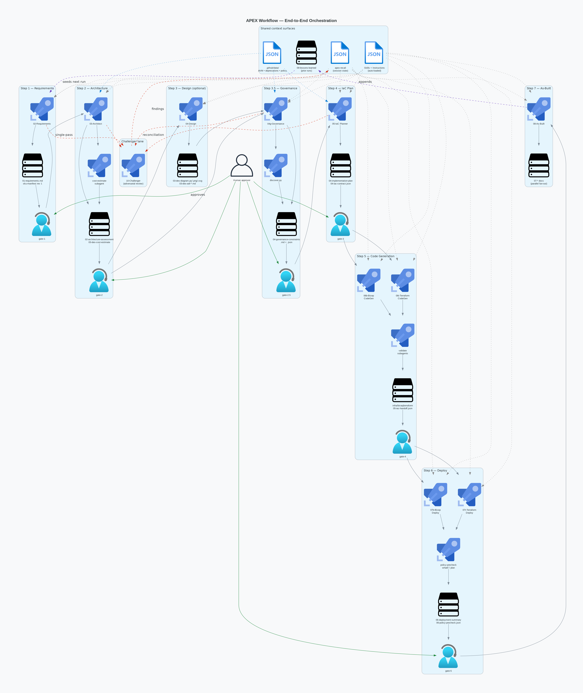
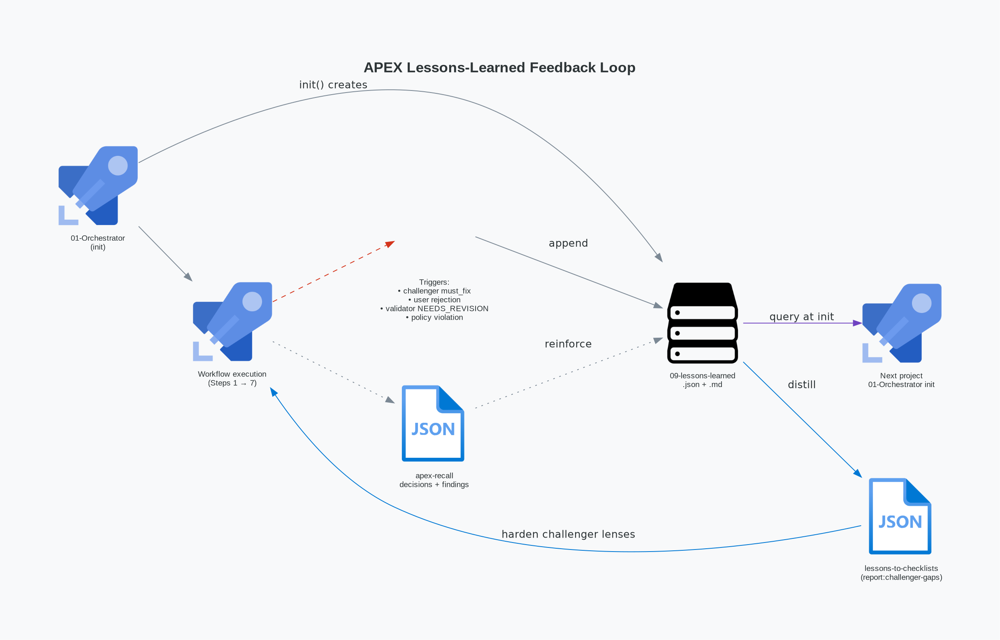

Read this page when you need to understand why a step needs particular evidence
or where a failed assumption should return. Use the [workflow overview](/concepts/workflow/)
for the normal sequence and the linked step pages for exact outputs.

## Mental model

A human selects a main agent. That agent reads current project evidence, performs
its task, and produces artifacts. Required reviews and approvals determine whether
the next step can proceed. Helpers can perform permitted bounded tasks, but the
main-agent sequence remains approval-gated. The
[current body migration](/concepts/how-it-works/agents/#current-agent-body-migration)
retains named roles while changing runtime task handling, not domain artifacts.

| Record                                      | Purpose                                                           | What it does not prove                                             |
| ------------------------------------------- | ----------------------------------------------------------------- | ------------------------------------------------------------------ |
| `agent-output/{project}/`                   | Requirements, decisions, reviews, contracts, and observed results | A file's presence does not establish freshness or approval.        |
| Primary session state through `apex-recall` | Current decisions, findings, and step progress                    | State does not authorize deployment or replace reviewed artifacts. |
| Workflow graph                              | Dependencies, expected outputs, and review defaults               | An edge does not execute an agent or grant permission.             |

## The five context surfaces

### Skills

An agent reads the skill required for its task, then relevant references or
templates. Discovery metadata helps identify a skill; it does not prove that its
instructions loaded. Load required guidance explicitly when needed.

### Instructions

An instruction's `applyTo` pattern describes intended file matching. Essential
approval and stop rules still belong in the main agent's instructions. Verify
runtime attachment separately from authoring-file syntax.

### `.github/data/` registries

Pinned AVM module catalogs, deprecation feeds, and `.github/data/alz-corp-policy-baseline.json.gz` give agents offline-verifiable reference data. The shared ALZ Corp baseline represents standard `root`, `landing_zones`, and `corp` archetypes (`assumed_corp_not_tenant_verified`), whereas adopter-owned `.github/data/governance-policy-baseline.json.gz` or private `policy-source` snapshots hold tenant-verified policy evidence.

### `apex-recall`

Use `apex-recall show <project> --json` and `apex-recall handoff <project> --json` to inspect current checkpoints, settled material decisions, review cycles, and gate readiness. See [session state debugging](/guides/session-debugging/) and [`show-schema.md`](https://github.com/jonathan-vella/apex/blob/7c195a1c8e06a5d0c3aa305d1870356e5829df92/tools/apex-recall/docs/show-schema.md).

### Hooks and validators

Git Lefthook and CI workflows run deterministic schema, contract, safe-shell, secret-scanning (`gitleaks`), and IaC security-baseline checks. Runtime `.github/hooks/` chat hooks remain retired; see [Copilot hooks](/concepts/how-it-works/workflow-engine/#copilot-hooks).

Independent semantic review runs separately through the read-only `challenger-review-subagent` and `record-review.mjs` (`APEX_REVIEW` or hash-bound `APEX_REVIEW_FILE`), enforcing fresh input hashes and zero unresolved `must_fix` findings before step completion. See [review finalization and recovery](/concepts/workflow/#review-finalization-and-recovery).

## Explicit lab risk acceptance

The [`risk-authorizations.md` contract](https://github.com/jonathan-vella/apex/blob/7c195a1c8e06a5d0c3aa305d1870356e5829df92/tools/apex-recall/docs/risk-authorizations.md) allows an authorized risk owner to accept specific unresolved default-mode Step 4 Plan findings in a `non-production-lab` environment (`risk-envelope-v1` / `risk-authorization-v1`) when remediation is not feasible.

Key invariants of `risk-authorization-v1`:

- Original findings, severities, file hashes, and the `NEEDS_REVISION` verdict remain untouched; the gate transitions to `exception-authorized` only after `apex-recall check-gate` verifies Ed25519 signatures against an operator-pinned external `APEX_RISK_TRUST_CONFIG` and a separate human `risk-gate-approval-v1` is recorded.
- An independent reviewer with a distinct principal signs `risk-eligibility-v1` for each finding. Applicable law, technical impossibility, failed deterministic validators, and deep-review or Step 1/2/3.5 blockers cannot be waived.
- Kit-maintainer authorizations cover only `plan-complete`, `codegen`, and `code-complete`. Lab deployment requires a separate adopter `deployment-risk-owner` authorization binding exact `tenant_id`, `subscription_id`, `event_id`, `tree_hash`, cleanup owner, and teardown obligations. Production reuse is prohibited.
- `apex-recall` also enforces step order, refusing out-of-order starts or completions unless an explicit `--allow-out-of-order "<reason>"` override is logged in `decisions.order_overrides`.

## Stage-by-stage walkthrough

### Step 0: project initialization

Identify the project and read existing state before initializing anything. Capture
the IaC choice through Requirements and retain explicit review-depth decisions.
Normal review is the default. Complexity does not silently enable deep review.

### Step 1: requirements

`02-Requirements` records the workload, constraints, and initial SKU manifest.
When directly selected, it asks about missing workload requirements through its
native question tool. A delegated worker returns `USER_INPUT_REQUIRED` to its
interactive parent instead. Complete the required independent review, resolve findings, and obtain
approval before architecture. Return here when an upstream requirement changes.

### Step 2: architecture

`03-Architect` evaluates service choices and costs. Direct selection supports
native questions about missing choices or constraints; it does not require
Orchestrator as a question relay. The architecture assessment
and cost estimate receive independent reviews. Deep architecture review is opt-in
and does not replace the cost-estimate review. Preserve pricing assumptions and
their source rather than substituting remembered prices.

### Step 3: design, optional

`04-Design` creates diagrams and decision records when they help explain the
architecture. Directly selected Design asks material questions about design intent
itself. Design review is optional. The next required concern is governance,
whether or not this step runs.

### Step 3.5: governance

`04g-Governance` discovers effective policy, including inherited assignments, and
produces both Markdown and JSON constraints. Reconcile conflicts before planning.
Directly selected Governance asks about missing target scope or policy decisions
through its native question tool. A delegated worker returns the question to its
interactive parent without calling user tools.
If resolution changes the architecture, return to Architect and renew the affected
approval. An inaccessible scope is not an empty policy result.

### Step 4: IaC plan

The shared `05-IaC Planner` selects modules and versions, maps policy requirements,
and produces the IaC contract, policy-property map, and environment manifest.
Review the plan before CodeGen. An architectural gap belongs with Architect, not
in an undocumented code-generation workaround.

### Step 5: code generation

Select `06b-Bicep CodeGen` or `06t-Terraform CodeGen`. Generate code from the approved
plan and produce `05-iac-handoff.json`. Run the required deterministic checks.
Adversarial code review is opt-in. Return planning defects to the planner instead
of changing approved inputs during generation.

### Step 6: deploy

Select the matching deployment agent. Check current code, handoff, environment,
policy evidence, and preview before obtaining apply authorization. Reused
validation must cover the current inputs.

Quota, SKU, or regional constraints can require a new design decision. Stop and
escalate rather than substitute a resource automatically. Record provisioning
results and application-health results separately.

### Step 7: as-built

`08-As-Built` documents the observed resource inventory, operations, costs,
compliance evidence, and recovery procedures. Include missing checks and unresolved
issues. Do not infer a healthy application from a completed provisioning operation.

### Post: lessons

Record recurring failures and their evidence during the run. Use the resulting
lessons to propose reviewed changes to agents, skills, or validators. A lesson
record does not authorize those changes automatically.

## End-to-end run timeline

The current sequence is Requirements, Architecture, optional Design, Governance,
Plan, CodeGen, Deploy, and As-built. The owner can select a main agent directly or
use Orchestrator to coordinate approved step dispatch. Native task results and
explicit selection replace UI handoff controls in the body migration.
`00-handoff.md` remains a durable artifact, not a UI declaration or approval.
The [step table](/concepts/workflow/#core-agents-by-workflow-step) names the agents,
and the [review matrix](/concepts/workflow/#adversarial-review-matrix) defines the
default reviews.

Historical workflow illustration

This imported illustration predates the current agent-body migration.
It remains available for old links and historical comparison, not as execution guidance.

The retained domain sequence and ownership are described in the text above.
Do not use the old delegation lanes to infer native tools, continuation support,
or runtime certification. The body migration removes readiness handshakes and log
preflight, but preserves review receipts, freshness checks, and approval gates.

## The lessons-learned feedback loop

Capture an observation, its cause, the evidence, and a proposed correction in
`09-lessons-learned.json`. The related Markdown record explains the lessons to
readers. Review proposed improvements before changing the product.

The product's `report:challenger-gaps` command can identify recurring lessons for
review. Its output is a proposal, not a new mandatory workflow rule.

### Illustrative lesson entry

A useful lesson says which step failed, what input exposed the problem, and what
should change. For example, a selected module version may lack a property required
by discovered policy. The correction belongs in module selection and policy
mapping, not in a deployment-time exception.

Use the [lesson schema](https://github.com/jonathan-vella/apex/blob/7c195a1c8e06a5d0c3aa305d1870356e5829df92/tools/schemas/lesson-log.schema.json)
for an actual record. An illustration is not evidence that a run occurred.

Historical lessons illustration

Reuse requires relevant evidence and reviewed changes. The illustration does not
imply automatic modification of agents or approval rules.

## APEX and Azure landing zones

An [Azure Landing Zone](https://learn.microsoft.com/azure/cloud-adoption-framework/ready/landing-zone/)
can supply management groups, policy, identity, networking, and shared services.
Discover what the target environment actually provides. APEX workload planning is
not a substitute for establishing the platform's ownership and controls.

### What greenfield means in APEX

A new workload can target an established landing zone. A new subscription can
still require platform setup. Distinguish the application's starting point from
the state of its Azure environment.

### What ALZ provides

Identify inherited policy, role assignments, network connectivity, DNS ownership,
and monitoring destinations. Verify resource IDs and permissions before referencing
central services. Do not assume every landing zone has the same deployment.

#### ALZ layer and APEX step consumer

| Platform concern                       | Workload step                                                                              |
| -------------------------------------- | ------------------------------------------------------------------------------------------ |
| Effective policy and inheritance       | Governance discovers constraints; Plan maps them to implementation.                        |
| Existing network and DNS ownership     | Architecture selects connectivity; Plan records references and responsibilities.           |
| Identity and role scope                | Plan and CodeGen implement the approved access model.                                      |
| Diagnostics and monitoring destination | Plan identifies ownership; CodeGen wires the approved resources; As-built records results. |

### How ALZ guardrails accelerate and de-risk APEX

Known policy and resource ownership reduce the choices a workload team must make.
They do not remove discovery, review, or connectivity checks. If a platform rule
conflicts with the design, resolve the conflict with its owner before generation
or deployment.

### When there is no landing zone

Record the absence of inherited controls and apply the canonical greenfield defaults (including the lowercase 9-tag set when live policy defines no tag contract). Do not copy the deprecated four-tag PascalCase convention. See [`.github/copilot-instructions.md`](https://github.com/jonathan-vella/apex/blob/7c195a1c8e06a5d0c3aa305d1870356e5829df92/.github/copilot-instructions.md). Failed discovery never proves that policy is absent.

## Network planning

### Bring your own VNet vs. create new

Establish whether the workload references an existing network or provisions a new one. For an existing VNet, verify its resource ID, address space, required subnets, and permissions without modifying platform-owned resources. For a new VNet, plan non-overlapping CIDRs, subnet delegations, and routing using [`vnet-planning.md`](https://github.com/jonathan-vella/apex/blob/7c195a1c8e06a5d0c3aa305d1870356e5829df92/.github/skills/apex-azure-defaults/references/vnet-planning.md).

### Hub-spoke and virtual WAN topologies

Identify who owns the hub, peering or Virtual WAN connection, routing, and firewall policy. Do not infer connectivity from the presence of a spoke VNet alone; verify traffic paths and return routes.

### Private DNS zones, enumeration and reuse

Verify relevant private DNS zone IDs, VNet links, permissions, and name resolution. Reuse central DNS zones only when platform ownership and `DeployIfNotExists` (`DINE`) behavior are verified; avoid duplicate DNS zone creation when verified DINE policies already manage zone groups, and escalate to the platform team if neither workload-side creation nor DINE links resolve the endpoint.

### Recommended corp enforcement pattern

Evaluate `Deny` and `DeployIfNotExists` assignments for their actual scope, parameters, managed identity permissions, and remediation behavior. Read the [security baseline](/reference/security-baseline/) for private PaaS data-service requirements and the conditional Azure Monitor public ingestion allowance.

## Appendix A: artifact contract reference

Use the [canonical workflow graph](https://github.com/jonathan-vella/apex/blob/7c195a1c8e06a5d0c3aa305d1870356e5829df92/.github/skills/apex-workflow-engine/templates/workflow-graph.json) and the [step guides](/concepts/workflow/#core-agents-by-workflow-step). Filename prefixes follow historical slots: Step 2 produces `03-des-cost-estimate.md`, Step 3.5 produces `04-governance-constraints.{md,json}`, Step 4 produces `04-*` contracts, and Step 5 produces `05-iac-handoff.json`.

## Appendix B: skills by step

Consult each agent's `.agent.md` file and the [Architecture Explorer](/reference/architecture-explorer/) for skill relationships.

## Appendix C: instruction scope

See [skills and instructions](/concepts/how-it-works/skills-and-instructions/) for `applyTo` globs and precedence tiers.

## Appendix D: glossary

See the [glossary](/reference/glossary/) for definitions of APEX terms and contracts.

## Appendix E: further reading

- [Workflow engine and validation](/concepts/how-it-works/workflow-engine/)
- [Session state debugging](/guides/session-debugging/)
- [Security baseline](/reference/security-baseline/)
- [Showcases](/showcases/)
