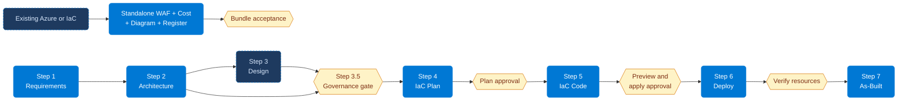

import { CardGrid, LinkCard } from "@astrojs/starlight/components";
import AgentChat from "../../components/AgentChat.astro";

<section class="landing-hero not-content">
  

    
APEX

    <h1 class="landing-hero__title">
      Agentic Platform Engineering for Azure
    </h1>
    
Assess existing Azure workloads or deliver policy-compliant Bicep and Terraform with GitHub Copilot agents, verified pricing, and human approval gates.

    

      <a class="sl-link-button primary not-content" href="getting-started/quickstart/">
        Get started
      </a>
      <a class="sl-link-button minimal not-content" href="showcases/">
        Explore showcases
      </a>
    

  

  

    

      <AgentChat />
    

  

</section>

<section class="landing-section scenario-frame not-content">
  

    
Two workflows

    <h2>Assess existing estates or deliver governed platforms</h2>
    
Coordinate specialists through <code>01-Orchestrator</code> in VS Code, inspect independent Challenger findings, and approve each stage before moving forward.

  

  

    

      

        
Standalone WAF assessment

        
Run <code>/waf-assess-existing</code> against read-only Azure subscriptions, local IaC, or both. APEX produces a five-pillar Well-Architected report, existing-state SVG diagrams, Cost Management analysis, and a prioritized action register.

      

      

        
Infrastructure delivery

        <ul class="scenario-checklist">
          <li>Requirements, SKU manifest, and retail-priced architecture trade-offs.</li>
          <li>Azure Policy discovery or shared Corp assumptions before planning.</li>
          <li>AVM-first Bicep or Terraform code verified by static and preflight gates.</li>
          <li>Gated deployment and as-built records grounded in observed Azure state.</li>
        </ul>
      

    

    

    

  

</section>

<section class="landing-section scenario-frame explore-section not-content">
  

    
Explore

    <h2>Choose a starting point</h2>
  

  

    <CardGrid>
      <LinkCard
        title="Brownfield WAF showcase"
        description="Inspect a four-subscription Azure assessment across 211 resources, Cost Management charts, and an 18-item action register."
        href="showcases/waf-assessment/"
      />
      <LinkCard
        title="CoE modernization archetype"
        description="Explore the Partner Modernization Factory CoE platform in a vended spoke with 8 ADRs, lab risk contracts, and 10 AVM Bicep modules."
        href="showcases/coe-archetype/"
      />
      <LinkCard
        title="Quickstart"
        description="Create a repository from the Accelerator template and launch your first delivery or assessment workflow."
        href="getting-started/quickstart/"
      />
      <LinkCard
        title="Standalone WAF guide"
        description="Copy a variable-based starter prompt to review live Azure subscriptions or offline IaC."
        href="guides/waf-assessment/"
      />
      <LinkCard
        title="Architecture Explorer"
        description="Inspect agents, helper subagents, skills, instructions, validators, and workflow edges interactively."
        href="reference/architecture-explorer/"
      />
      <LinkCard
        title="APEX MicroHack"
        description="Run the one-day hands-on team challenge from requirements capture through multi-region DR."
        href="https://microhack.apexops.pro/"
      />
    </CardGrid>
  

</section>
