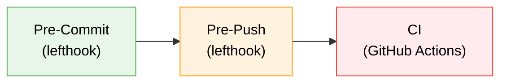

This page catalogs the validators, linters, Lefthook Git hooks, and CI workflows in the pinned `apex` repository (`7c195a1c8e06`). Run these commands inside an `apex` or `apex-accelerator` checkout, not `apex-docs`.

Runtime `.github/hooks/` chat hooks remain retired; deterministic enforcement runs through `apex-recall`, `record-review.mjs`, the scripts below, Git Lefthook, and GitHub Actions CI. See [Copilot hooks](/concepts/how-it-works/workflow-engine/#copilot-hooks).

For the `apex-docs` site repository, run `npm run source:prepare`, `npm run build`, `npm run check:links`, `npm run check:docs`, `npm test`, and `npm run test:browser`.

:::tip[Quick reference]

- Pre-commit runs the fastest, file-scoped checks (`markdown-lint`,
  `agents`, `iac-security-baseline`, …).
- `npm run validate:all` is the product's broad local validation entry
  point.
- CI uses its configured suites and path filters. A passed local hook does not
  establish that all CI or runtime checks passed.
- Git commit and push hooks are defined in [`lefthook.yml`](https://github.com/jonathan-vella/apex/blob/main/lefthook.yml).

:::

**Jump to:** [Architecture](#validation-architecture) ·
[Lefthook Hooks](#lefthook-hooks) ·
[Validation Scripts](#validation-scripts) ·
[CI Workflows](#ci-workflows) ·
[Running Locally](#running-validations-locally)

## Validation architecture

### Stabilization checks

CodeGen proceeds in dependency-ordered batches of up to three new source files, with focused validation after
each edit and a root check at each batch boundary. Routine next-file permission is not required. Explicit user
stop requests, unresolved errors, ownership changes and human approval gates still stop progression.

Use these read-only commands from the repository root:

```bash
node tools/scripts/resolve-deployment-inputs.mjs --input approved-discovery-snapshot.json
node tools/scripts/validate-iac-handoff.mjs --tree-hash infra/bicep/example
node tools/scripts/summarize-deployment-preview.mjs --input preview.json --tool bicep --expected-ids expected.json
node tools/scripts/validate-policy-precheck.mjs precheck.json --preview preview.json --expected-ids expected.json
node tools/scripts/validate-provider-payload.mjs --input resolved-resources.json --s2-max-bytes 268435456000
```

The input resolver consumes approved values and read-only discovery snapshots; it performs no Azure calls or
identity mutations. Its default report omits resolved values. See the [input snapshot contract][input-snapshot].
An unset environment variable is not a reason to ask again for an already approved value.

Capture Bicep what-if with `--no-pretty-print --output json`. The summarizer returns exit 0 for checked evidence,
2 for required review and 1 for invalid or blocked evidence. Expected IDs come from approved resource bindings,
including child resources, not from copying the observed result. A passing preview never grants apply permission.

For unexpected Bicep `Ignore` records only, both preview commands support `--ignored-evidence bundle/ignored.json`.
The [ignored-resource evidence contract][ignored-evidence] binds exact preview/expected-ID hashes to saved
parent/child observations. It supports private-endpoint NICs, SQL `master` and Storage-linked system topics,
with exact IDs and reasons, not wildcard exclusions. The records remain visible in the summary. Changed actions,
missing managed resources and unknown coverage still block; relationship evidence does not confer apply approval.

Provider-payload checks cover known SQL S2 and App Service Plan regressions only. Supply a concrete resource array
extracted from generated payloads with recorded provenance; unresolved expressions remain unverified. The example
SQL byte size must be checked against the target region's capabilities and approved configuration before use.
Compilation, provider validation, preview and successful deployment are distinct outcomes.

[input-snapshot]: https://github.com/jonathan-vella/apex/blob/main/.github/skills/apex-azure-defaults/references/identity-resolution.md#resolve-before-asking
[ignored-evidence]: https://github.com/jonathan-vella/apex/blob/main/.github/skills/apex-iac-common/references/deploy-shared-workflow.md#accounted-ignored-resources

Validation runs at three stages, catching issues progressively earlier:



1. Pre-commit runs configured checks. Publication Markdown/artifact checks use the staged index.
2. Pre-push selects domain checks for changed files.
3. CI runs the suites and filters declared by the current workflow.

## Lefthook hooks

The Git hooks listed here are defined in `lefthook.yml` at the repository root.

### Pre-commit hooks

Markdown and artifact checks run through `node tools/scripts/check-publication-scope.mjs markdown|artifacts`.
They materialize an isolated index snapshot, so partially staged files are checked as committed. Unrelated untracked
projects cannot block publication. Template, artifact-guidance and validator changes still run H2/template and review
presence checks across all tracked artifacts in that snapshot. Markdown uses the installed local executable; failures
propagate without filtering away exit codes. These checks never format, stage or rewrite project files.

| Hook                    | Trigger (glob)                                      | Purpose                                               |
| ----------------------- | --------------------------------------------------- | ----------------------------------------------------- |
| `markdown-lint`         | `*.md`                                              | markdownlint on staged markdown files                 |
| `artifact-validation`   | Staged artifacts, templates, guidance and validators | H2/template and review presence checks on tracked snapshot |
| `agents`                | `**/*.agent.md`, `**/*.prompt.md`                   | Agent frontmatter, model alignment, body size         |
| `instructions`          | `**/*.instructions.md`, agents, skills              | Instruction frontmatter and cross-reference validity  |
| `secrets-baseline`      | _(all staged files)_                                | gitleaks secret scan (soft-skip if not installed)     |
| `python-lint`           | `tools/mcp-servers/**/*.py`                         | Ruff linter on Python files                           |
| `terraform-fmt`         | `*.tf`                                              | Terraform formatting check                            |
| `terraform-validate`    | `*.tf`                                              | Terraform validation per project                      |
| `iac-security-baseline` | `infra/bicep/**/*.bicep`, `infra/terraform/**/*.tf` | TLS 1.2, HTTPS-only, no public blob, managed identity |

### Commit-msg hook

| Hook         | Purpose                                                                     |
| ------------ | --------------------------------------------------------------------------- |
| `commitlint` | Enforce [Conventional Commits](https://www.conventionalcommits.org/) format |

### Pre-push hooks

| Hook               | Purpose                                             |
| ------------------ | --------------------------------------------------- |
| `branch-naming`    | Validate branch name uses an approved prefix        |
| `branch-scope`     | Validate domain branches only modify in-scope files |
| `diff-based-check` | Run domain-scoped validators for changed file types |

## Validation scripts

All scripts are in the `tools/scripts/` directory. Run via `npm run <command>`.

### Architecture and registry validators

| npm Command | Script | Purpose |
| --- | --- | --- |
| `validate:agents` | `validate-agents.mjs` | Agent and prompt frontmatter, body contracts, vendor rules, and handoff rules |
| `validate:skills` | `validate-skills.mjs` | Skill `apex-` naming, frontmatter, references, and stale-name checks |
| `validate:skill-checks` | `validate-skill-checks.mjs` | `SKILL.md` line budget and reference integrity |
| `validate:instruction-checks` | `validate-instruction-checks.mjs` | Instruction frontmatter and `applyTo` glob rules |
| `validate:agent-registry` | `validate-agent-registry.mjs` | `tools/registry/agent-registry.json` consistency |
| `validate:workflow-graph` | `validate-workflow-graph.mjs` | Delivery and assessment DAG integrity |
| `validate:explorer-graph` | `validate-explorer-graph.mjs` | Strict Architecture Explorer graph schema and edge checks |
| `validate:context-budget` | `validate-context-budget.mjs` | Per-step prompt and instruction token-budget ceilings |
| `validate:models` | `validate-models.mjs` | Model policy consistency and deprecated-model checks |

### Artifact and template validators

| npm Command | Script | Purpose |
| --- | --- | --- |
| `validate:artifacts` | `validate-artifacts.mjs` | H2 template compliance and auto-fix (`--fix`) |
| `check:h2-order` | `check-h2-order.mjs` | Artifact H2 heading sequence check |
| `validate:sku-manifest` | `validate-sku-manifest.mjs` | `sku-manifest.json` schema, monotonic revisions, allowlist cross-check, and TTL freshness |
| `validate:sku-iac-coverage` | `validate-sku-iac-coverage.mjs` | Bidirectional SKU consistency between `sku-manifest.json` and generated Bicep/Terraform |

### Governance and compliance validators

| npm Command | Script | Purpose |
| --- | --- | --- |
| `lint:governance-refs` | `validate-governance-refs.mjs` | Governance discovery guardrail references |
| `validate:governance-baseline` | `validate-governance-baseline.mjs` | Shared ALZ Corp and tenant governance baseline archive integrity |
| `validate:region-canonical` | `validate-region-canonical.mjs` | Canonical `swedencentral` / `westeurope` / `germanywestcentral` region defaults |
| `validate:no-hardcoded-counts` | `validate-no-hardcoded-counts.mjs` | Blocks hard-coded entity counts across agents, skills, instructions, and root docs |
| `lint:deprecated-refs` | `validate-no-deprecated-refs.mjs` | Blocks retired agent filenames, retired skills, and deprecated paths |
| `validate:terminology` | `validate-terminology.mjs` | Enforces `.github/terminology-blocklist.json` |
| `validate:iac-security-baseline` | `validate-iac-security-baseline.mjs` | Enforces TLS 1.2, HTTPS-only, no public blob, Managed Identity, Entra-only SQL, and private networking |

### Session and state validators

| npm Command | Script | Purpose |
| --- | --- | --- |
| `validate:session-state` | `validate-session-state.mjs` | `00-session-state.json` schema and deprecated-field checks |
| `validate:decision-keys` | `validate-decision-keys.mjs` | Validates `apex-recall` decision keys against `decision-keys.md` |
| `validate:question-batching` | `validate_question_batching.py` | Enforces `ask_user` schema shape, material-input context mapping, and no companion `*_other` fields |
| `validate:challenger-presence` | `validate-challenger-presence.mjs` | Verifies required `challenge-findings-*.json` sidecars across delivery steps and standalone assessment bundles, plus zero `step2_residue` files |
| `validate:challenger-findings` | `validate-challenger-findings.mjs` | Verifies Challenger sidecar schema, SHA-256 input freshness (`--verify-cache`), and immutable `supporting_inputs` |
| `validate:challenger-decisions` | `validate-challenge-findings-decisions.mjs` | Validates finding disposition records |
| `validate:risk-authorizations` | `validate-risk-authorizations.mjs` | Validates signed Ed25519 `risk-envelope-v1` lab risk authorizations and approvals |

### Quality and cross-reference validators

| npm Command | Script | Purpose |
| --- | --- | --- |
| `lint:glob-audit` | `validate-glob-audit.mjs` | Detects overly broad `applyTo` globs |
| `lint:orphaned-content` | `validate-orphaned-content.mjs` | Detects unreferenced skills and references |
| `lint:docs-freshness` | `check-docs-freshness.mjs` | Detects stale filenames and hardcoded version banners |
| `audit:retirement` | `audit-retirement-candidates.mjs` | Whole-repository tracked-file census and retirement checks |
| `lint:version-sync` | `validate-version-sync.mjs` | Version consistency across manifests |
| `lint:safe-shell` | `safe-shell.mjs` | Blocks interactive shell flags (`-i`, `read -p`) and unsafe pipelines in committed snippets |

### Configuration validators

| npm Command | Script | Purpose |
| --- | --- | --- |
| `validate:vscode` | `validate-vscode-config.mjs` | VS Code workspace and dev container settings consistency |
| `validate:extension-bloat` | `validate-extension-bloat.mjs` | Rejects denylisted chat-bloating extensions in `.devcontainer/devcontainer.json` |
| `lint:mcp-config` | `validate-mcp-config.mjs` | Validates workspace-root `.mcp.json` |
| `validate:mcp-tool-refs` | `validate-mcp-tool-refs.mjs` | Verifies referenced Azure MCP tool names against pinned `@azure/mcp` snapshot |
| `validate:tool-versions` | `validate-tool-versions.mjs` | Verifies pinned dev container CLI versions and checksums |

### Code and format linters

| npm Command | Tool | Purpose |
| --- | --- | --- |
| `lint:md` | `markdownlint-cli2` | Markdown formatting and heading rules |
| `lint:prose` | `vale` | Microsoft and APEX prose style rules on `.github/` and `README.md` |
| `format:check` | `prettier` | Formatting check for JS, JSON, YAML, and CSS |
| `lint:js:ci` | `eslint` | Zero-warning ESLint check across `tools/scripts` and `tools/tests` |
| `lint:links` | `check-repository-links.mjs` | Repository relative and external link validation |
| `lint:json` and `lint:json-schemas` | `lint-json.mjs` / `validate-json-schemas.mjs` | JSON/JSONC syntax and Ajv schema validation |
| `lint:python` | `ruff` | Python lint check on `tools/apex-recall/src/` |
| `lint:powershell` | `PSScriptAnalyzer` | PowerShell script analysis |
| `lint:terraform-fmt` and `validate:terraform` | `terraform` | Recursive HCL formatting and module validation |
| `lint:bicep-fmt` | `bicep format` | Bicep formatting check |

### Aggregate commands

| npm Command          | Purpose                                       |
| -------------------- | --------------------------------------------- |
| `validate:all`       | Run cache-aware Node validators plus external validators |
| `validate:_node`     | Node validators in one cache-sharing process; bounded children for Python, ESLint, and tests |
| `validate:_external` | All external tool validators in parallel      |
| `validate:agents`    | Agent frontmatter, body, model alignment      |
| `validate:artifacts` | H2 sync, template compliance, auto-fix        |
| `validate:skills`    | Skill format, affinity, references, stale     |
| `audit:quarterly`    | Quarterly context audit checks                |
| `audit:retirement`   | Generate or inspect the whole-repository retirement census |

> `validate:_external` is a **local-developer** aggregate (run all external-tool
> linters in one shot). In CI its members are gated individually so coverage does
> not depend on the aggregate: `lint:md` and `format:check` run in `ci.yml`,
> `lint:python` runs in the `ci.yml` external-tests job. Inspect current workflow
> steps for the remaining external checks; do not assume a retired `iac-checks.yml`
> still runs them. Site checks belong to the separate apex-docs repository.

`validate:_node:legacy` and `validate:_node-ci:legacy` retain the former
unbounded `run-p` aggregates as rollback and benchmark baselines.

### Agent-invoked IaC validators (runtime, not CI)

These validators are run **by agents during the workflow** against generated
artifacts in Steps 4 through 6, not by lefthook or CI. They have no committed inputs on
`main`, so they are intentionally absent from the aggregates above.

| npm Command | Invoked by | Validates |
| --- | --- | --- |
| `validate:iac-contract` | `05-IaC Planner` | `04-iac-contract.json` schema and phase DAG |
| `validate:iac-contract-consistency` | `05-IaC Planner` | `04-iac-contract.json` vs. `04-implementation-plan.md` |
| `validate:iac-handoff` | `06b-Bicep CodeGen` / `06t-Terraform CodeGen` | `05-iac-handoff.json` and IaC tree hash |
| `validate:environment-manifest` | `05-IaC Planner` | `04-environment-manifest.json` |
| `validate:policy-property-map` | `05-IaC Planner` | `04-policy-property-map.json` |
| `validate:policy-precheck` | `07b-Bicep Deploy` / `07t-Terraform Deploy` | `06-policy-precheck.json` vs. deployment preview |
| `sync:draft-contract-hashes` | `05-IaC Planner` | Refreshes `plan_ref` and `l1m_ref` digests of an unapproved draft contract (`--write` updates atomically) |

#### Contract validator rules

- `validate:iac-contract --readiness --stage deploy|post-deploy|go-live` (default
  `deploy`) fails an unresolved required capability only when its optional `blocks`
  list includes that stage or an earlier one. Without `blocks` a capability blocks
  every stage.
- A `phase` or `deployment_phase` parameter may not declare a `default`.
- Resources may declare `phase`, `consumes` (resources reached over a private path)
  and, on private endpoints, `target`. A `depends_on` into a later phase fails, and a
  consumer must `depends_on` a private endpoint that targets what it consumes.
  Contracts without these fields are not checked.
- `validate:iac-contract-consistency` requires every resource without an AVM module
  entry to appear in the plan's `### Raw Resource Exceptions` section when that
  section exists.
- `validate:policy-property-map` accepts `status` per policy: `satisfied`, `pending`,
  `not-applicable` (needs `not_applicable_reason`) and `unsatisfiable` (fails).

## CI workflows

All workflows are in `.github/workflows/`.

This table describes the pinned product configuration, not proof that migration
callers have been retired. Its historical runtime-hook checks do not authorize
hook restoration or disabling unrelated CI.

| Workflow                  | File                            | Trigger                      | Purpose                                                                                            |
| ------------------------- | ------------------------------- | ---------------------------- | -------------------------------------------------------------------------------------------------- |
| CI                     | `ci.yml`                        | PR to `main`, push to `main` | Full validation suite (markdown, Prettier, agents, skills, hooks, bats tests, MCP, VS Code config) + Python ruff in the external-tests job |
| Branch Enforcement        | `branch-enforcement.yml`        | PR to `main`                 | Branch naming convention and scope validation                                                      |
| Consumer Template Checks | `consumer-template-checks.yml` | Configured template checks | Validate consumer-template behavior |
| Dev Container Base Validation | `validate-devcontainer-base.yml` | Relevant PR changes or manual dispatch | Compare candidate container bases on native architectures |
| Upstream Skill Drift | `upstream-skill-drift.yml` | Weekly (Monday 06:00 UTC) or manual dispatch | Compare the reviewed `microsoft/azure-skills` tag with the latest release (`npm run report:upstream-skills`) and keep one labelled issue up to date; never edits skills |

The apex-docs repository owns the site's build and publishing workflows.
Product validation does not publish documentation.

## Running validations locally

```bash
# Run everything
npm run validate:all

# Run a specific category
npm run lint:md                    # Markdown only
npm run validate:agents            # Agent definitions only
npm run validate:session-state     # Session state only

# Auto-fix where supported
npm run lint:md:fix                # Fix markdown issues
npm run fix:artifacts -- <file> --apply  # Fix artifact H2 headings
npm run lint:python:fix            # Fix Python lint issues
```

## Focused contract tests and manual workflow acceptance

<span id="run-focused-checks"></span>

### Run focused contract suites

When modifying `apex` tooling, run the targeted test suite covering your change before running `npm run validate:all`:

```bash
npm run test:tool-contracts
npm run test:validator-runner
npm run test:apex-recall
npm run test:python-tools
npm run test:governance-discovery
npm run test:devcontainer-verdicts
```

<span id="perform-manual-acceptance"></span>

### Perform manual workflow acceptance

Static validators verify file contracts, schemas, and hashes; they do not test live VS Code Copilot agent discovery or cloud execution. For end-to-end workflow changes, exercise `01-Orchestrator` in the VS Code **Copilot** target across fresh and resumed (`resume <project>`) runs, verifying question batching, both mandatory Step 2 Challenger reviews (`comprehensive` and `cost-feasibility`), and human stage gates.

<span id="migrate-from-the-retired-harness"></span>

### Retired autonomous E2E harness

The early autonomous RALPH E2E subsystem (`e2e:validate`, `e2e:benchmark`, `e2e:combine`, `test:lib-e2e`) is permanently retired without replacement wrappers. `tools/schemas/lesson-log.schema.json` still tolerates historical `workflow_mode: "e2e"` entries in archived lesson files, while active validation uses the unit suites above plus human-gated runs.

---

<span id="related"></span>

:::tip[Further reading]

- [Contributing](../../project/contributing/) for branch naming and pull-request checks
- [Workflow engine and validation](../../concepts/how-it-works/workflow-engine/) for `apex-recall` gates and retired Copilot hooks
- [Dev container base validation](../../guides/devcontainer-base-validation/) for multi-arch container CI

:::
